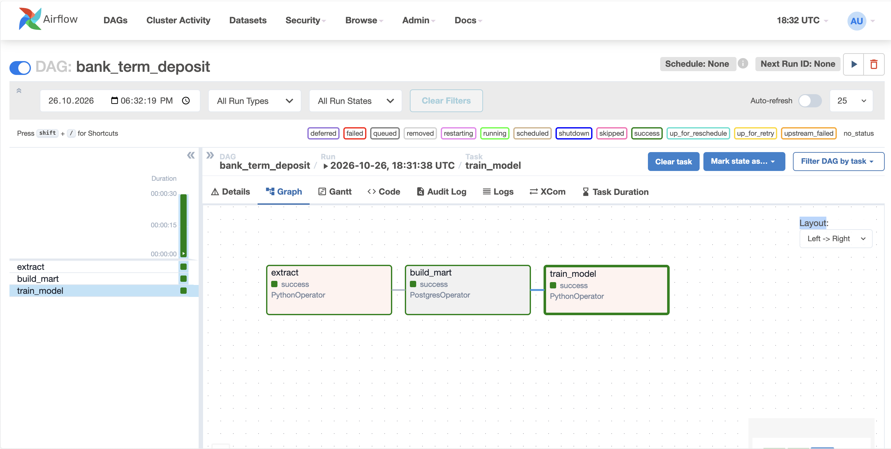
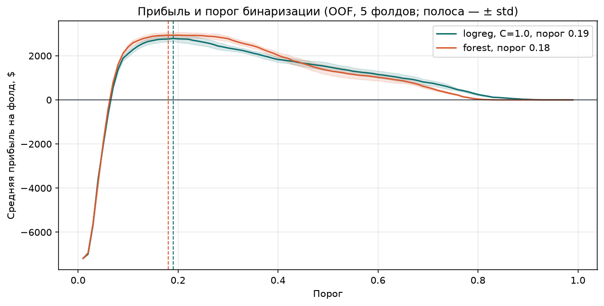
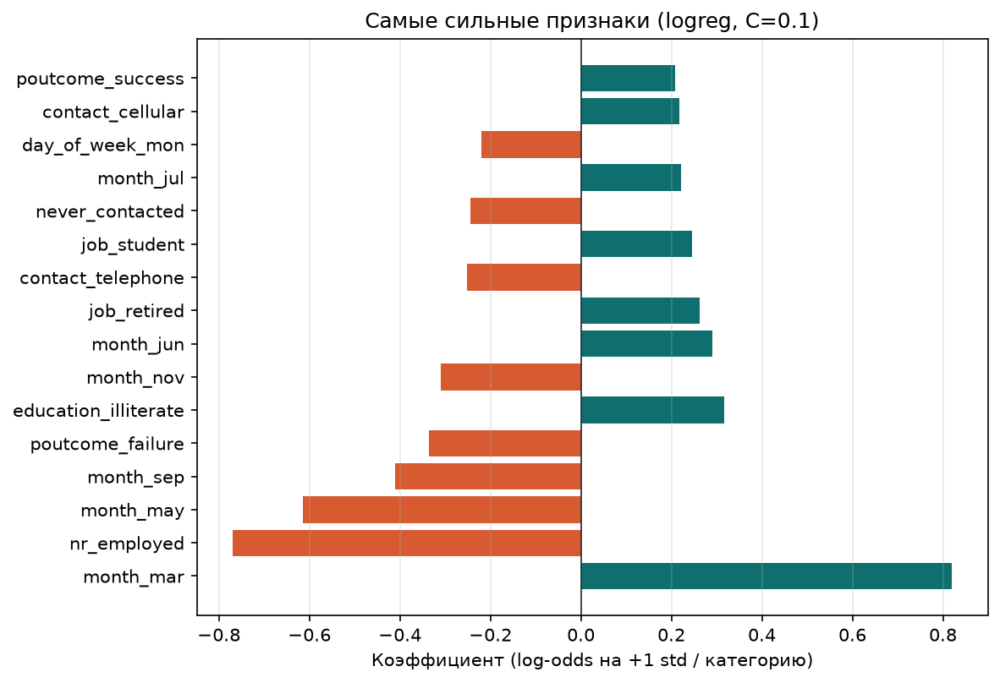
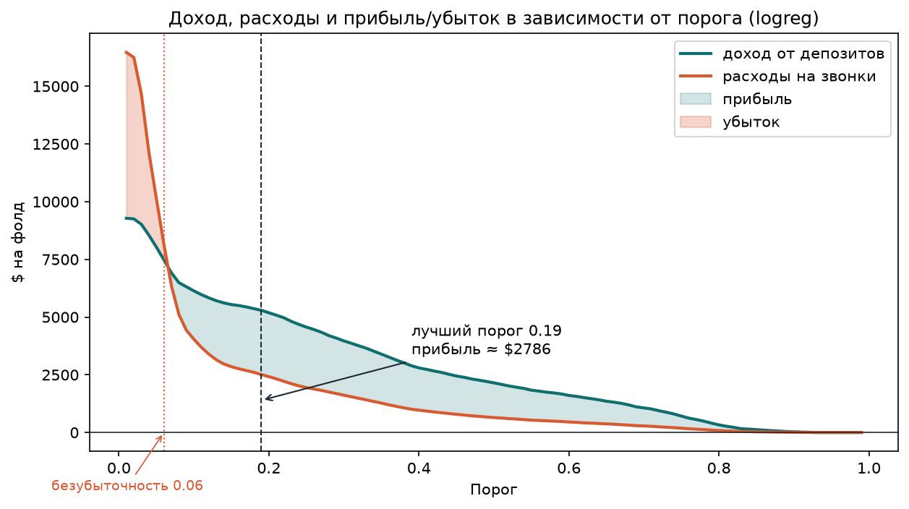

# bank-term-deposit-ml

**Кому звонить: ML-пайплайн для банковской кампании по депозитам**

## О проекте

Банк обзванивает клиентов и предлагает срочный депозит. Один звонок стоит **2 доллара**.
Если клиент соглашается, банк зарабатывает **10 долларов**. Если звонить всем подряд,
расходы на звонки могут превысить доход. Задача — определить, кому звонить в первую
очередь, чтобы кампания приносила прибыль.

В проекте обучаются две модели: логистическая регрессия и случайный лес. В прод идёт
логистическая регрессия (`models/campaign_model.joblib`), лес обучается на тех же данных
для сравнения. Почему выбран именно такой вариант — в разделе «Почему логистическая
регрессия».

**Стек:** Airflow · Postgres · pandas · scikit-learn · Docker Compose.

---

## Запуск

```bash
make airflow
```

- Airflow: http://localhost:8088. Логин `admin`, пароль `admin` (dev-окружение;
  в проде — секреты через env / secret manager).
- Postgres: `localhost:5432`. База `dwh`, пользователь `admin`, пароль `admin`.

В интерфейсе Airflow включите переключатель у DAG `bank_term_deposit` и нажмите
«Trigger» для запуска.

Остановить:

```bash
make down
```

Требования: Docker, `make`. Команда поднимает Airflow + Postgres через `docker compose`.

---

## Как устроен проект

Проект состоит из трёх шагов. Шаги выполняются по очереди в Airflow.

```text
extract → build_mart → train_model
```



**Шаг 1 — `extract`.** Скачивает zip-архив с сайта UCI, распаковывает и читает CSV.
Загружает данные в таблицу `raw_contacts` в Postgres (перезаписывает, если таблица была).

**Шаг 2 — `build_mart`.** Выполняет SQL-скрипт. Создаёт две таблицы: `ods_contacts`
(промежуточная, некоторые колонки переименованы) и `mart_campaign_features` (итоговая, только
колонки, нужные модели; `pdays` обработан — добавлен `never_contacted`).

**Шаг 3 — `train_model`.** Читает `mart_campaign_features`, обучает две модели на пяти
фолдах кросс-валидации, подбирает порог вероятности по прибыли, сохраняет модели
и записывает метрики в `mart_model_metrics`.

---

## Данные

Данные взяты с сайта UCI: файл `bank-additional-full.csv` внутри zip-архива.
В таблице 41 188 строк и 22 колонки. Целевая колонка `y` — согласился клиент на депозит
или нет. Соглашаются около 11% клиентов, остальные 89% отказываются — классы
несбалансированы. Поэтому accuracy обманчива: модель «всегда no» даёт 89%.
Качество ранжирования оцениваем по PR-AUC, а решение «звонить/не звонить» принимаем
по бизнес-метрике прибыли `10·TP − 2·calls`, а не по accuracy.

Ссылка на данные и адрес базы хранятся в файле `airflow/jobs/config.py`.

### Какие колонки не попали в обучающую таблицу и почему

В обучающую таблицу `mart_campaign_features` попали не все колонки из исходных данных.
Причины такие.

| Колонка | Что с ней сделано | Почему |
|---|---|---|
| `duration` | Удалена | Длительность последнего разговора известна только после звонка. Если оставить — модель подглядывает ответ (leakage), на новых данных бесполезна. |
| `emp_var_rate` и `euribor3m` | Удалены | Макроэкономические показатели, почти полностью повторяют `nr_employed` (корреляция 0.91). Оставлен только `nr_employed`. |
| `pdays` | Не входит в модель; вместо неё `never_contacted` | Значение `999` означает «не звонили»; как число искажает масштаб (выброс для `StandardScaler`). Вводим бинарный `never_contacted` (1 — не звонили, 0 — звонили) |

Подробный анализ корреляций — в ноутбуке `notebooks/01_EDA.ipynb`.

---

## Модели

В проекте две модели, они сохранены в файлы `models/campaign_model.joblib` и
`models/tree_model.joblib`: название модели, сама модель и порог вероятности. Порог нужен
при применении: если модель предсказала вероятность согласия выше порога — клиенту
звоним, иначе не звоним.

### Почему логистическая регрессия, а не случайный лес

Прибыль forest на OOF: **2936 ± 127 \$**, logreg: **2786 ± 116 \$**. Разница 150 \$ меньше
суммарного разброса `√(116² + 127²) ≈ 172 $` — статистически незначима, поэтому
выбираем logreg.



На графике полосы ± std вокруг линий прибыли пересекаются почти на всём диапазоне
порогов — модели статистически неразличимы по прибыли.

Кроме того, перебор `C` показал, что PR-AUC почти не зависит от `C` в диапазоне
0.01–100 (все ~0.446 ± 0.02) — logreg устойчива к выбору гиперпараметра. У леса
несколько параметров, и оптимум может оказаться локальным.

**Понятность.** Банку нужно объяснять бизнес-подразделению, почему конкретному клиенту
предлагают депозит. У логистической регрессии есть коэффициенты, которые прямо
показывают вклад каждого признака

### Какие признаки важны

Коэффициенты логистической регрессии (на стандартизованных признаках) показывают вклад
в log-odds согласия:



Признаки группируются по смыслу.

- **Экономический фон.** `nr_employed` — уровень занятости. Чем он ниже, тем чаще берут
  депозит.

- **Волна обзвона.** `month_*` — конкретная волна кампании с её экономическим фоном
  и составом клиентов, а не «удачный календарный месяц». У большинства месяцев вес
  небольшой; сильнее всего выделяются март (положительно) и май (отрицательно).

- **Прошлая кампания.** `poutcome_failure` (прошлый отказ) имеет отрицательный вес,
  `poutcome_success` (прошлый успех) — положительный: история контактов информативна.

- **Канал связи.** Стационарный телефон (`contact_telephone`) против мобильного
  (`contact_cellular`) связан с более низкой склонностью брать депозит.

- **Кто клиент.** `job_retired` и `job_student` — обе группы чаще среднего говорят «да»,
  `education_illiterate` — тоже положительный вес, но категория малочисленная, поэтому
  коэффициент шумный. На фоне волны обзвона и экономики это второстепенные сигналы.

### Как подбирались параметры моделей

Параметры подбирались отдельно, в ноутбуке `notebooks/02_hyperparams.ipynb`. Для
логистической регрессии перебирался параметр `C`, для случайного леса — глубина деревьев,
минимальное число объектов в листе и число признаков для разбиения. Найденные значения
записаны в `airflow/jobs/config.py`.

В самом Airflow-процессе параметры уже не перебираются — Airflow берёт готовые значения
из конфига и обучает финальную модель.

### Метрики на OOF (mean ± std по 5 фолдам)

| Модель | Порог | Прибыль, $ | ROC-AUC | PR-AUC | Precision | Recall | Accuracy |
|---|---|---|---|---|---|---|---|
| LogReg | 0.19 | 2786 ± 116 | 0.788 ± 0.006 | 0.446 ± 0.020 | 0.423 ± 0.013 | 0.570 ± 0.012 | 0.864 ± 0.004 |
| RandomForest | 0.18 | 2936 ± 127 | 0.795 ± 0.007 | 0.466 ± 0.020 | 0.427 ± 0.013 | 0.595 ± 0.014 | 0.864 ± 0.004 |

`±` — std по 5 фолдам. `Прибыль` — средняя на фолд при пороге из колонки `Порог`,
`profit = 10·TP − 2·calls`. Accuracy приведена для справки: при доле «yes» ~11% она
обманчива.

---

## Почему порог вероятности не 0.5

Порог подбирается по прибыли: перебираются значения от 0.01 до 0.80 с шагом 0.01,
для каждого считается средняя прибыль на фолдах, выбирается порог с максимальной
прибылью. Это делает функция `choose_threshold` в `airflow/jobs/training.py`
(на графиках диапазон расширен до 1.0 для наглядности).



На графике видна точка безубыточности — порог, ниже которого кампания убыточна. Левее
этой точки модель зовёт так много клиентов, что расходы на звонки превышают доход
от депозитов.

---

## Ноутбуки

Два ноутбука описывают работу, которая делалась до сборки Airflow-процесса.

**`notebooks/01_EDA.ipynb`** — разведочный анализ. Считаются корреляции между колонками,
показан дисбаланс классов и объясняется, почему из обучающей таблицы убраны `duration`,
`emp_var_rate`, `euribor3m` и `pdays`.

**`notebooks/02_hyperparams.ipynb`** — подбор параметров моделей, важность признаков,
графики «прибыль в зависимости от порога». Результаты подбора перенесены в `config.py`.


## Что дальше

- MLflow для версионирования моделей.
- Drift-мониторинг (evidently).
- CI: pytest + ruff на GitHub Actions.
- Инкрементальная загрузка в DWH.


